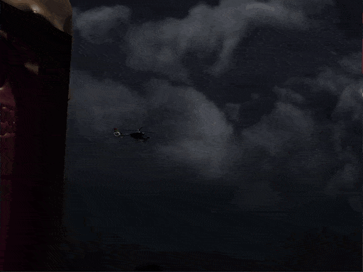

# 3D Terrain Rendering

A real-time OpenGL 4.6 scene in C++: a tessellated heightmap terrain at night, explored in first person, with water, a skybox, several kinds of lights, normal mapping, models loaded with Assimp and a few shader effects.

<p align="center">
  
</p>

The full demo video is in [`media/demo.mp4`](media/demo.mp4).

## Features

**Terrain**
- Generated from a grayscale heightmap. Tessellation shaders (control and evaluation) add detail to the terrain mesh on the GPU.
- The camera walks on the terrain surface, with simple gravity, jumping, running and swimming at the water level.

**Lighting and materials**
- A directional light, four coloured point lights and a flashlight (a spot light attached to the camera, with a light texture).
- Normal mapping and specular mapping on a cobblestone surface.
- Models with several meshes and textures, loaded with Assimp.

**Effects**
- Animated water (three moving layers of a normal map) and transparent windows, rendered with alpha blending; the windows are sorted back to front.
- Skybox.
- Object outline with the stencil buffer.
- Explosion of a model in a geometry shader (press **P**).

**Scene**
- Grass, trees and windows placed at random positions.
- A helicopter whose rotor meshes are animated separately, and skulls that turn towards the camera.

## Controls

| Key | Action |
|---|---|
| W A S D | move |
| Mouse | look around |
| Scroll | zoom |
| Left Shift | run |
| Space | jump |
| P | explosion |
| Esc | quit |

## Building

Requirements: CMake 3.14 or newer, a C++17 compiler and a GPU with OpenGL 4.6. GLFW, GLM and Assimp are downloaded and built by CMake (an installed Assimp is used if CMake finds one); GLAD and stb_image are included in the repository.

```bash
cmake -S . -B build -DCMAKE_BUILD_TYPE=Release
cmake --build build --config Release
```

The first configure downloads the dependencies and the first build compiles Assimp, so both take a few minutes.

## Running

The build copies the shaders (`Glsls/`) and the resources (`Resources/`) next to the executable, and the program loads them with relative paths, so run it from `build/bin`:

```bash
cd build/bin
./terrain_rendering
```

## Known issues

- Gravity is applied once per frame instead of per second, so the camera's vertical movement depends on the frame rate. It was tuned on the machine the project was developed on; on noticeably faster or slower hardware, jumping, falling and the way the camera follows the terrain can look different (for example, the camera can float or bounce when looking up while walking).
- The projection matrices use the initial window size (1024×768), so resizing or maximizing the window stretches the image.
